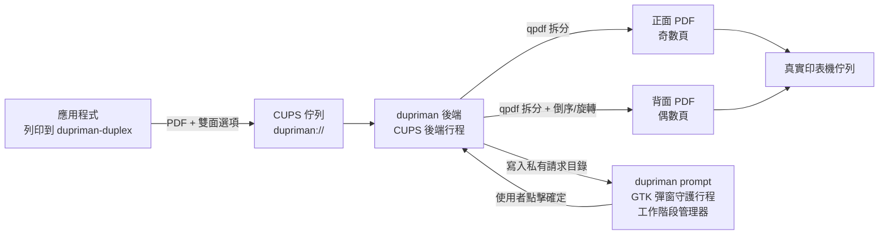

# DupriMan — 手動雙面列印助手

[English](README.md) | [简体中文](README.zh_CN.md) | **繁體中文**

為**單面印表機**（如 HP LaserJet 1020，foo2zjs 驅動）提供近乎自動的雙面列印體驗：
在任意應用的列印對話框中，選擇虛擬印表機 **dupriman-duplex**，並選擇
**關閉 / 長邊翻轉 / 短邊翻轉** 雙面模式。它將：

1. 列印**所有正面**（奇數頁，全部份數）；
2. 彈出 GTK 對話框，提示重新放入紙張；
3. 點擊**確定**後列印**所有背面**（偶數頁）。

## 架構



- **後端**（`dupriman backend`，由 cupsd 呼叫）：解析雙面選項，用 qpdf 拆分奇偶頁，提交到真實印表機佇列，並在繼續之前**等待實體列印完成**。
- **彈窗守護行程**（`dupriman prompt`，執行於使用者圖形工作階段）：後端會在 `/run/dupriman` 下為提交使用者建立私有目錄。請求與回應均校驗檔案所有者和隨機 capability，本機其他使用者無法讀取工作中繼資料或偽造確認。取消或逾時會安全中止背面列印工作。
- **多份拷貝**：PPD 宣告了 `cupsManualCopies`，因此份數會透傳到真實佇列——先列印全部正面（×N），彈窗一次，再列印全部背面（×N）。

## 依賴

執行時：`cups`、`qpdf`、`poppler`（pdfinfo）、`gtk4`（>= 4.10）
建構：`rust` / `cargo`、`pkg-config`

Arch Linux：

```bash
sudo pacman -S --needed cups qpdf poppler gtk4 rust
```

## 手動整合

### Arch Linux:

```bash
paru -S dupriman-git
```

### 從原始碼安裝

```bash
cargo build --release
```

DupriMan 不會自行安裝檔案、建立 CUPS 佇列、管理執行期目錄或啟用服務。
安裝二進位、CUPS backend 符號連結及 `dupriman ppd` 生成的 PPD 後，明確執行：

```bash
# cupsd 執行 backend 所使用的帳戶：Debian/Ubuntu 為 lp，Arch 為 cups
getent passwd lp >/dev/null && BACKEND=lp || BACKEND=cups
echo "backend account: $BACKEND"

sudo install -d -o root -g root -m 0711 /run/dupriman
sudo install -d -o "$BACKEND" -g "$BACKEND" -m 0700 /var/tmp/dupriman
sudo install -d -m 0755 /etc/dupriman
sudo sh -c 'dupriman sample-config > /etc/dupriman/config.toml'
sudo lpadmin -p dupriman-duplex -v dupriman://duplex \
  -P /usr/share/cups/model/dupriman.ppd -E
```

設定 `printer.real` 與明確的 `prompt.allowed_users`。

**後端帳戶是探測出來的，不是寫死的。** 上游 CUPS（以及 Debian/Ubuntu）以 `lp`
執行 backend，但 Arch Linux 與 Fedora 只提供 `cups` 帳戶——在那裡
`getent passwd lp` 是空的。DupriMan 優先使用 `paths.backend_user`；未設定時依
`lp`、`cups` 順序取第一個存在的帳戶；目錄存在後以 `requests/` 的擁有者為準，
列印時不再做任何猜測。

每個允許的帳戶均須建立專用 bridge group 和私有目錄布局；以下以 `alice` 為例
（`$BACKEND` 已在上方設定）：

```bash
sudo groupadd --system dupriman-alice
sudo usermod -a -G dupriman-alice alice
sudo usermod -a -G dupriman-alice "$BACKEND"
sudo install -d -o root -g root -m 0711 /run/dupriman/alice
sudo install -d -o "$BACKEND" -g dupriman-alice -m 2750 /run/dupriman/alice/requests
sudo install -d -o alice -g dupriman-alice -m 2770 /run/dupriman/alice/responses
```

`/run` 在多數系統上是 tmpfs，重新開機後上述布局會消失。可用 tmpfiles.d 條目持久化
（systemd 系統），並省去上面的 `install -d`：

```bash
sudo tee /etc/tmpfiles.d/dupriman.conf >/dev/null <<EOF
d /run/dupriman 0711 root root -
d /run/dupriman/alice 0711 root root -
d /run/dupriman/alice/requests 2750 $BACKEND dupriman-alice -
d /run/dupriman/alice/responses 2770 alice dupriman-alice -
EOF
sudo systemd-tmpfiles --create /etc/tmpfiles.d/dupriman.conf
```

backend 以 CUPS backend 帳戶寫入請求，圖形使用者讀取請求並寫入回應。其他本機使用者沒有存取
權限，且列印背面前仍會驗證回應 UID 與隨機 capability。變更群組成員後需要登出再登入。
最後以所選 init、桌面 autostart 或工作階段管理器監管每個允許圖形工作階段中的
`dupriman prompt`。

執行 `dupriman test` 可檢查以上各項：它會顯示探測到的後端帳戶、狀態目錄，以及每個
允許使用者的 bridge 布局是否已供應。

## 設定

**你應當先使用CUPS添加你的真實印表機。**

backend 只讀取 `/etc/dupriman/config.toml` 和明確的 `--config` 參數。使用者級配置只適合覆蓋彈窗文案；不要覆蓋印表機或路徑設定。完整註解範例：`dupriman sample-config`。

關鍵選項（預設值適用於大多數出紙面朝下的雷射印表機）：

```toml
[printer]
# 特殊值 "save-pdf"：不列印，子作業儲存到 spool_dir/saved/（測試模式，預設）
# 實機列印時改為實際佇列名，如 "HP_LaserJet_1020"（lpstat -v 查看）
real = "save-pdf"
virtual_name = "dupriman-duplex"  # lpadmin 建立的虛擬佇列名，須與實際佇列一致

[paths]
# cupsd 執行 backend 所用的帳戶；留空則自動探測（先 lp，再 cups）
backend_user = ""

[duplex]
even_order = "reverse"           # 背面頁序：reverse（倒序）| normal（正序）

[duplex.long_edge]
even_rotate = 180                # 長邊翻轉：背面旋轉角度

[duplex.short_edge]
even_rotate = 0                  # 短邊翻轉：背面旋轉角度

[prompt]
language = "auto"                # 對話框語言：auto | en | zh_CN | zh_TW
timeout_secs = 600               # 0 = 永久等待；逾時後中止
allowed_users = ["alice"]         # 允許確認雙面工作的本地帳戶
```

### 國際化（i18n）

對話框與 CLI 提示語言由 `prompt.language` 控制：

| 值 | 語言 |
|---|---|
| `auto` | 從 `LC_ALL` / `LC_MESSAGES` / `LANG` 自動偵測（預設） |
| `en` / `en_US` | 英語 |
| `zh_CN` | 簡體中文 |
| `zh_TW` | 繁體中文 |

所有翻譯都已**編譯進二進位檔**，因此安裝後的副本不需要額外的資料目錄。
`/usr/share/dupriman/i18n/`（或二進位檔旁邊的 `./i18n/`）中的檔案會覆蓋內嵌版本，
方便打包者不重新編譯就更新譯文。

彈窗裡的放紙示意圖原始檔是 `assets/paper-orientation.svg`，由
`scripts/render-diagram.sh` 轉成 `assets/paper-orientation.png` 後編譯進二進位檔。
要改圖請編輯 SVG（不是 PNG），重跑該腳本再重新編譯。之所以轉成 PNG 而不直接
內嵌 SVG，是因為 gdk-pixbuf 不一定帶 SVG loader（Arch 的 `librsvg` 只提供
`rsvg-convert`，不裝 loader）。

也可以直接在設定裡覆蓋任意文案（優先級最高）：

```toml
[prompt]
title = "我的自訂標題"
message = "請把紙放回去"
ok_label = "繼續"
cancel_label = "停止"
```

### 方向或頁序不對？

預設值假設**出紙面朝下的輸出紙盤**，使用者操作是
**從輸出紙盤取出整疊紙，原樣放回進紙槽**：

| 症狀 | 修復方法 |
|---|---|
| 背面頁序反了（最後一頁在最上面） | `duplex.even_order = "normal"` |
| 背面顛倒（長邊翻轉） | `duplex.long_edge.even_rotate = 0` |
| 背面顛倒（短邊翻轉） | `duplex.short_edge.even_rotate = 180` |
| 出紙面朝上的印表機（如部分噴墨） | `duplex.even_order = "normal"` + 對調兩個 `even_rotate` 值 |

建議先用 3–4 頁的文件測試（測試模式下檢查 `/var/tmp/dupriman/saved/` 的 PDF 即可，不耗紙）。

## 使用方法

在列印對話框中選擇 **dupriman-duplex**，然後選擇雙面模式：

- **關閉**：直接轉發到真實印表機；
- **長邊翻轉**（預設）：適用於縱向文件，沿長邊翻轉（背面旋轉 180°）；
- **短邊翻轉**：適用於橫向文件，沿短邊翻轉（背面不旋轉）。

正面列印完成後，**不要翻轉或重新排序**——從輸出紙盤取出整疊紙，原樣放入進紙槽，然後點擊確定。彈窗裡有一張示意圖說明這一點：**A** 代表文字方向，A 的頂端就是頁首；放入紙匣時 A 面（已列印面）朝**下**，頁首朝向**印表機**。

## 日誌與故障排除

- 後端日誌：`journalctl -u cups` 或 `/var/log/cups/error_log`（前綴 `[dupriman]`）
- 彈窗守護行程：查看所選工作階段管理器的日誌
- 自檢：`dupriman test`
- 如果請求雙面列印時彈窗守護行程未執行：正面會正常列印，之後後端等待並在 `prompt.timeout_secs` 後安全中止。
- **正面列印完後一直沒有彈窗，佇列裡工作一直等**：最常見的原因是**目前登入工作階段早於 `dupriman-<使用者>` 群組建立**。群組成員關係在登入時固定，所以新建群組後必須登出再登入，`dupriman prompt` 才能讀到 `requests/`。`dupriman test` 會明確回報「目前工作階段可讀取 bridge 目錄」一項未通過；守護行程啟動時也會直接以該原因結束，而不是空轉。臨時驗證可先 `newgrp dupriman-<使用者>`。
- **早已取消的工作仍不斷彈出確認框**：`requests/` 裡的請求檔比它的後端活得久。現在彈窗會跳過後端 PID 已消失的請求（或超過 `prompt.timeout_secs + 60` 的），後端在寫入新請求前也會順手清理殘留檔案。舊版本寫的檔案沒有 PID，只能等 24 小時後清理；可立即用 `sudo rm /run/dupriman/<使用者>/requests/*.json` 清除。
- **正面列印完後卡住，或報 "required account `lp` does not exist" / "prompt state ... is not provisioned"**：代表 bridge 目錄未供應，或後端執行在 DupriMan 未供應的帳戶下。用 `dupriman test` 檢查——它會顯示探測到的後端帳戶以及你帳戶所需的 `install -d` 指令。在 Arch/Fedora 上後端帳戶是 `cups`，不是 `lp`。
- **`dupriman test` 報虛擬印表機缺失，但佇列可正常列印**：`printer.virtual_name` 必須與 `lpadmin` 建立的佇列名完全一致（區分大小寫）。`lpstat -v` 可列出真實佇列名。
- **雖然設定了 `prompt.language = "zh_CN"`，對話框仍顯示英文**：明確的 `language` 總是優先，但 `auto` 跟隨 locale，且僅 `LANG=en_US.UTF-8` 就會選到英文，即使其他 `LC_*` 類別是中文。請明確設定 `language = "zh_CN"`，或匯出 `LC_MESSAGES=zh_CN.UTF-8`。
- **雙面任務失敗後佇列變成 disabled**：後端非零結束會讓 CUPS 停用佇列。用 `cupsenable <佇列>` 重新啟用，用 `cancel -a <佇列>` 清掉卡住的作業。
- 偵錯拆分結果：設定 `print.keep_temp = true`；暫存 PDF 將保留在 `paths.spool_dir` 中。

## 移除

使用包管理器刪除軟體包，用其所屬工作階段管理器停止 prompt 服務；如不再使用
佇列，執行 `lpadmin -x dupriman-duplex`。配置與執行期目錄由管理員明確管理。

## 開發

```bash
cargo test            # 單元測試 + 真實 qpdf 拆分測試
tests/e2e.sh          # 端到端模擬（save-pdf 模式，不耗紙）
cupstestppd <(./target/debug/dupriman ppd)   # 驗證 PPD
```

### 新增語言

1. 從 `i18n/en_US.toml` 複製建立 `i18n/<locale>.toml`，翻譯所有鍵。
2. 在 `src/i18n.rs` 中註冊（全部集中在一處）：
   - `Lang` 列舉：新增變體，帶上 serde rename 和 alias
   - `Lang::ALL`：加入新變體
   - `Lang::from_env()`：新增從 `LC_ALL`/`LC_MESSAGES`/`LANG` 偵測語言的邏輯
   - `Lang::file_stem()`：對應到語言檔名
   - `BUILTIN`：加入 `("<locale>", include_str!("../i18n/<locale>.toml"))`，
     讓譯文一併編譯進二進位檔
3. 更新[國際化](#國際化i18n)中的語言表（可選）。

缺失的鍵會自動回退到 `en_US`。`dupriman ppd` 透過 `Lang::ALL` 自動發現所有語言，無需修改打包腳本。

### 已測試硬體

本軟體僅在 **Arch Linux** 上的 **HP LaserJet 1020** + **foo2zjs** 驅動上測試過。
如果你在其他印表機型號或驅動上測試，歡迎回報結果或提交 PR，
尤其是適合你裝置的 `even_order` 和 `even_rotate` 設定值。
